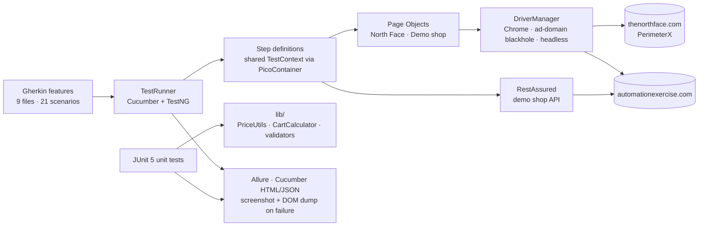
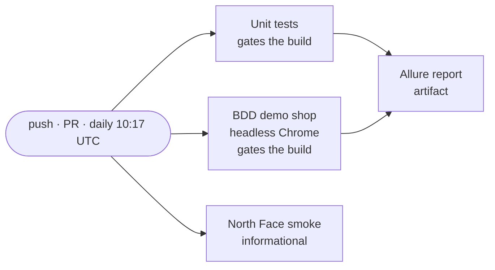

<div align="center">

# 🏔️ NorthFace × Automation Exercise — BDD Test Automation Framework

### Selenium + Cucumber + TestNG UI tests, RestAssured API tests and JUnit 5 unit tests, run against a bot-protected retail site and a live demo shop, in CI every day

[+%C2%B7+headless+in+GitHub+Actions)](https://git.io/typing-svg)

<!-- ============ STATUS BAR ============ -->
[](https://github.com/rbchy/NorthFace_AutomationExercise-BDD-Test-Automation/actions/workflows/ci.yml)


</div>

---

## 📌 At a Glance

<table>
<tr>
<td width="50%" valign="top">

**🙋 What this is**

A multi-layer QA framework built against two real websites.

**[thenorthface.com](https://www.thenorthface.com/)** is a production retail site protected by **PerimeterX**. It gets bot-safe smoke checks only.

**[automationexercise.com](https://automationexercise.com/)** is a live demo shop. It gets the full suite:
- search → add to cart → checkout
- sign-up and login, positive and negative
- its public REST API
- accessibility and page-load checks

Pure price, cart and validator logic is covered by fast JUnit 5 tests.

The whole thing runs **headless in GitHub Actions** on every push and once a day, so a change on the live sites shows up even when nobody commits. The results come together in one **Allure** report.

</td>
<td width="50%" valign="top">

**📍 Quick facts**

| | |
|---|---|
| 🥒 **BDD** | 9 features · 21 scenarios |
| 🔌 **API** | 6 RestAssured scenarios |
| 🧪 **Unit** | 64 JUnit 5 tests |
| ✅ **CI** | 64 unit + 19 BDD green · ≈ 4.5 min |
| 🛡️ **North Face** | 2 smoke checks, skipped with the reason when blocked |
| 📊 **Reports** | Allure · Cucumber HTML / JSON · DOM dumps |
| 🧰 **Extras** | JMeter load plan · OWASP ZAP baseline |

</td>
</tr>
</table>

---

## ✅ Latest Results (GitHub Actions)

| Job | What runs | Result |
|---|---|---|
| **Unit tests** | `mvn test -Punit`: price parsing / discounts, cart maths, email & password validators, cent-exact rounding | ✅ 64 / 64 |
| **BDD – demo shop** | headless Chrome, `(@smoke or @regression) and not @northface`: UI, E2E, auth, API, accessibility, performance | ✅ 19 / 19 |
| **North Face smoke** | `@northface` on the real site | ⏭️ 2 skipped: *"Blocked by the site's bot protection – CDN 'Access Denied' page"* |
| **Allure report** | merges unit and BDD results into one report (downloadable artifact) | ✅ |

> **Why the North Face checks are skipped in CI.** GitHub's cloud runners get an `Access Denied` page from the site's CDN, a 298-byte page instead of the store. That says nothing about the store itself. So the framework now **detects the bot wall** and marks those two scenarios as *skipped, with the reason*, instead of failing with a misleading "logo not displayed".
>
> From a normal home or office network they run and pass. The local run gives 21 / 21 Cucumber scenarios ([PDF](docs/reports/Cucumber%2021%20Pass%20Report.pdf)).

---

## 🏗️ How It Fits Together



### 🔁 CI pipeline



---

## 🎯 Test Coverage

| Layer | Feature / class | Tool | +/− | Count |
|---|---|---|:--:|:--:|
| 🔥 Smoke | North Face home page: logo, title, navigation | Selenium + Cucumber | + | 2 |
| 🔥 Smoke | Demo shop home page loads | Selenium + Cucumber | + | 1 |
| 🔎 Search | Data-driven: dress / top / jeans / tshirt (`Scenario Outline`) | Selenium + Cucumber | + | 4 |
| 🚫 Negative search | Gibberish term shows no products | Selenium + Cucumber | − | 1 |
| 🛒 E2E | Search → add first product → cart → checkout offered | Selenium + Cucumber | + | 1 |
| 🔐 Auth | Start sign-up with a random email · invalid login rejected | Selenium + Cucumber | +/− | 2 |
| 🔌 API | productsList · brandsList · searchProduct (with / without term) · verifyLogin (no params / unknown user) | RestAssured | +/− | 6 |
| ♿ Accessibility | Document `lang`, non-empty title, search field has an accessible name | Selenium + JS | +/− | 2 |
| ⚡ Performance | Page load within budget · guard check that the timer works | Selenium | +/− | 2 |
| 🧪 Unit | `PriceUtils` · `CartCalculator` · `EmailValidator` · `PasswordValidator` · `MoneyRoundingTest` | JUnit 5 | +/− | 64 |
| 📈 Load | Demo API load plan | Apache JMeter | — | scaffold |
| 🛡️ Security | Passive baseline scan | OWASP ZAP | — | scaffold |

---

## ⚙️ Framework Highlights

- **BDD + Page Object Model:** readable Gherkin, and every locator lives in one page class.
- **Dependency injection (PicoContainer):** one `TestContext` per scenario, no static state.
- **Config-driven:** URLs, browser, headless mode, timeouts and the performance budget are in `config.properties`. Any of them can be overridden with `-Dkey=value`.
- **Self-documenting failures:** a screenshot goes into the report, and the live DOM is dumped to `target/dom-dumps/`.
- **Flakiness controls:** Google Vignette ad domains are blackholed at the Chrome layer, and the tests navigate by direct URL.
- **Environment vs defect:** an anti-bot page is detected and reported as *skipped, with the reason*, not as a product bug.
- **Reproducible dependencies:** `allure-bom` + `junit-bom` stop Allure from pulling in a Cucumber `messages` version that conflicts with Cucumber 7.18.

---

## ▶️ Running the Tests

**You need:** JDK 17+, Maven 3.8+, Google Chrome (the driver is managed automatically), and internet access.

```bash
# Full Cucumber suite (UI + E2E + API + a11y + perf) - 21 scenarios
mvn clean test                                   # Windows: run-all.bat

# JUnit unit tests - 64 tests, no browser
mvn clean test -Punit                            # Windows: run-unit.bat

# By tag
mvn clean test -Dcucumber.filter.tags="@smoke"   # Windows: run-smoke.bat
mvn clean test -Dcucumber.filter.tags="@demo"    # Windows: run-demo.bat
mvn clean test -Dcucumber.filter.tags="@api"

# Exactly what CI runs
mvn test -Dheadless=true "-Dcucumber.filter.tags=(@smoke or @regression) and not @northface"

# Everything + interactive Allure report
./run-report.sh                                  # Windows: run-report.bat
```

| Report | Where |
|---|---|
| **Allure** (unit + Cucumber in one) | `mvn allure:serve`. In CI, download the **allure-report** artifact and serve it over HTTP: `python3 -m http.server`, because it does not open from `file://`. |
| **Cucumber HTML / JSON** | `target/cucumber-reports/report.html` (screenshots attached on failure) |
| **DOM dumps** | `target/dom-dumps/<scenario>.html` for every failed UI scenario |
| **Saved reports from a local run** | [`docs/reports/`](docs/reports): Allure overview / suites / timeline PDFs, Cucumber 21-pass PDF |

---

## 📁 Project Structure

```text
NorthFace_AutomationExercise-BDD-Test-Automation/
├── .github/workflows/ci.yml          # unit · BDD · North Face smoke · Allure report · daily schedule
├── src/test/java/com/northface/automation/
│   ├── pages/                        # North Face page objects
│   │   └── demo/                     # Automation Exercise page objects
│   ├── stepdefinitions/              # Common · DemoShop · Auth · Api · Accessibility · Performance · Hooks
│   ├── runners/TestRunner.java       # Cucumber + TestNG
│   ├── utils/                        # ConfigReader · DriverManager
│   ├── lib/                          # PriceUtils · CartCalculator · EmailValidator · PasswordValidator · Money
│   └── unit/                         # JUnit 5 tests for lib/
├── src/test/resources/
│   ├── features/                     # 9 .feature files
│   └── config.properties
├── qa-extras/                        # JMeter load plan · OWASP ZAP baseline scripts
├── docs/reports/                     # saved Allure / Cucumber reports (PDF / HTML)
├── run-*.bat · run-report.sh         # one-click runners
├── testng.xml
└── pom.xml                           # junit-bom + allure-bom · `unit` profile
```

---

## 🧹 Maintenance Log

The README was checked against the code, and these issues were fixed:

| Issue found | Fix |
|---|---|
| ❌ **No CI.** The README listed `.github/workflows/ci.yml` and "CI on every push", but the file did not exist. | Added a workflow with four jobs, a daily run, and an Allure report artifact |
| 💲 **Prices were off by a cent.** `PriceUtils` / `CartCalculator` rounded binary doubles: $10.10 at 25 % off gave **$7.57** (should be $7.58), and $10.10 + 15 % tax gave $11.61 (should be $11.62). The old tests used a 0.001 tolerance on easy numbers, so they never saw it. | Switched to decimal (`BigDecimal`) half-up rounding, added `MoneyRoundingTest` with exact comparisons, and now reject NaN / infinity / null prices and negative shipping |
| 🛡️ **North Face failures were misleading.** From cloud IPs the site returns *Access Denied*, and the tests reported "logo not displayed". | The bot wall is detected and reported as **skipped, with the reason**. A real missing logo would still fail. |
| 🪟 **Windows scripts were missing.** `run-all.bat`, `run-unit.bat`, `run-demo.bat`, `run-smoke.bat` and `run-report.bat` were documented but not in the repo. | Added them (same content as the author's local copies) |
| 📂 **Reports cluttered the root.** Nine report PDFs / HTML files sat in the repo root. | Moved to `docs/reports/`, and added a `.gitignore` |
| 📝 **Stale README claims:** "CI badge removed from this fork", a count of 69 tests, and the CI section | Rewritten to match the code and the CI results |

---

## 📈 Roadmap

- [ ] Parallel scenarios (`@DataProvider(parallel = true)`), with one browser per thread already supported by `DriverManager`
- [ ] Firefox / Edge, and BrowserStack or Sauce Labs for the North Face smoke from residential IPs
- [ ] Complete the checkout flow (address → payment → order confirmation) on the demo shop
- [ ] Publish the Allure report to GitHub Pages
- [ ] axe-core for a full accessibility audit
- [ ] Run the JMeter and ZAP scaffolds against a self-hosted target in CI

---

## 🔗 Related Projects

| Project | Stack |
|---|---|
| 🌲 [QaBrains Automation – Cypress](https://github.com/rbchy/QaBrainsAutomationCypressJavaScript) | Cypress · JavaScript · CI |
| 🎭 [QaBrains Automation – Playwright TypeScript](https://github.com/rbchy/QaBrainsAutomationTypeScriptPlaywright) | Playwright · TypeScript · CI |
| 🏦 [ParaBank Banking Automation](https://github.com/rbchy/ParaBank-BankingAutomationJavaSelenium) | Java · Selenium · CI |
| 📱 [Appium Automation – API Demos](https://github.com/rbchy/AppiumAutomation_ApiDemos) | Appium · Android · CI |
| ⭐ [RbcTcsWorld E-Commerce Suite](https://github.com/rbchy/RbcTcsWorld_ECommerceSuite) | Spring Boot · REST Assured · Selenium · Playwright · CI quality gates |

<sub>All projects: [github.com/rbchy](https://github.com/rbchy)</sub>

---

## ⚠️ Disclaimer

This is a **portfolio / training project**. The tests only read public pages of thenorthface.com, and they stop (skip) as soon as its bot protection challenges them. Transactional flows run on automationexercise.com, a site published for automation practice.

---

## 👤 Author

<div align="center">

**Ranajit Baran Chowdhury (RB Chowdhury)**
QA Automation Engineer / SDET · West Norriton, Pennsylvania, USA

[](https://www.linkedin.com/in/rbchy/)
[](https://github.com/rbchy)
[](https://rbchy.github.io/rbchy/)
[](https://rbc6543.wixsite.com/rbc-portfolio)
[](mailto:chyranajit@gmail.com)

<sub>MIT licensed — see [LICENSE](LICENSE).</sub>

⭐ *If this project helps you, a star on the repo is appreciated.*

</div>
